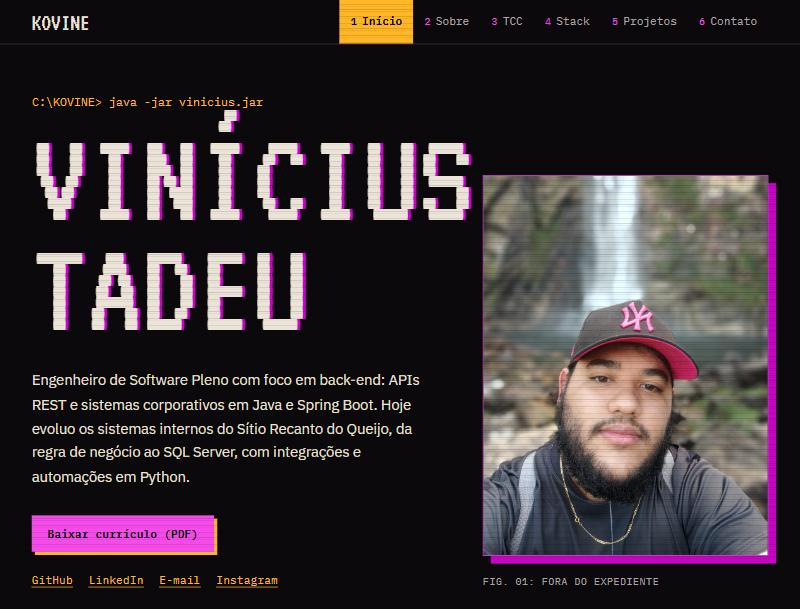

# Portfólio de Vinícius Tadeu (Kovine)

Meu site pessoal: experiência, TCC, stack e projetos, com a cara de um terminal antigo.

**No ar:** [portfolio-kovine.netlify.app](https://portfolio-kovine.netlify.app/)



## Stack

| Parte | Tecnologia |
| --- | --- |
| Interface | Vue 3 (Options API) e Vue Router 4 |
| Build | Vue CLI 5 |
| Estilo | CSS próprio, com variáveis em `src/assets/tema.css` |
| Fontes | VT323, IBM Plex Sans e IBM Plex Mono |
| Contato | EmailJS e máscara de telefone com vue-the-mask |
| Hospedagem | Netlify |

## Rodando na sua máquina

Testado com Node.js 22.

```bash
npm ci
npm run serve
```

O site abre em `http://localhost:8080`. Para gerar a versão de produção na pasta `dist/`:

```bash
npm run build
```

## Onde mudar cada coisa

| O que | Arquivo |
| --- | --- |
| Cores e fontes | `src/assets/tema.css` |
| Menu, atalhos e rodapé | `src/App.vue` |
| Apresentação e links | `src/components/Home.vue` |
| Experiência e formação | `src/components/Sobre.vue` |
| TCC | `src/components/Tcc.vue` |
| Stack | `src/components/Servicos.vue` |
| Projetos | `src/components/Portfolio.vue` |
| Formulário | `src/components/Contato.vue` |
| Currículo em PDF | `public/Currículo - Vinicius Tadeu Andrade Costa.pdf` |

## Formulário de contato

O envio é feito direto do navegador pelo [EmailJS](https://www.emailjs.com/), sem back-end próprio. O template recebe os campos `nome`, `email`, `telefone`, `assunto` e `mensagem`. A chave que aparece no código é a chave pública do EmailJS, feita para ficar no front-end.

## Publicação

Cada push na `main` gera uma nova publicação no Netlify. O arquivo `public/_redirects` faz rotas como `/sobre` funcionarem quando abertas direto pelo link.

## Versões

| Tag | O que tem |
| --- | --- |
| [`v1`](https://github.com/ViniciusTAC/portfolio/tree/v1) | Primeira versão do site, feita com Vuetify |
| [`v1.2`](https://github.com/ViniciusTAC/portfolio/tree/v1.2) | Visual retrô, conteúdo alinhado ao currículo e foco em Java e Spring Boot |

## Contato

[LinkedIn](https://www.linkedin.com/in/vinicius-tadeu-andrade-costa) · [GitHub](https://github.com/ViniciusTAC) · [Formulário no site](https://portfolio-kovine.netlify.app/contato)
